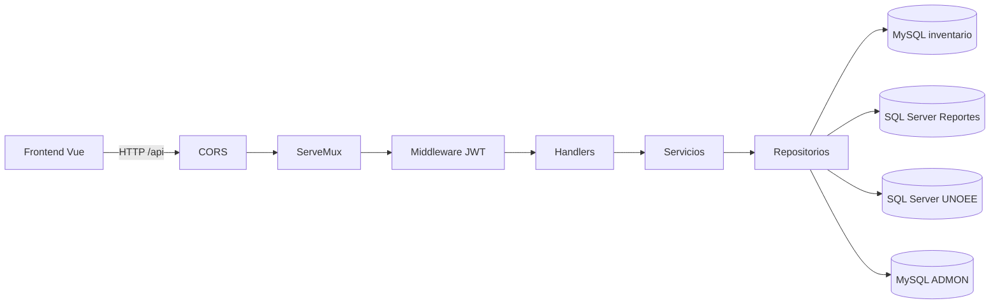

# Documentación Técnica – Backend

API REST (`auth-service`) del sistema de **inventario de herramientas y carritos**. Escrita en **Go** con `net/http`, guarda usuarios, inventarios y préstamos en **MySQL** y consulta empleados, ubicaciones e ítems en un **SQL Server** corporativo (Reportes y UNOEE) y en un **MySQL ADMON** (solo lectura).

## Índice

1. [Stack](#1-stack)
2. [Arquitectura](#2-arquitectura)
3. [Estructura de carpetas](#3-estructura-de-carpetas)
4. [Principios SOLID aplicados](#4-principios-solid-aplicados)
5. [Endpoints](#5-endpoints)
6. [Modelo de datos](#6-modelo-de-datos)
7. [Autenticación y roles](#7-autenticación-y-roles)
8. [Variables de entorno](#8-variables-de-entorno)
9. [Comandos](#9-comandos)
10. [Despliegue](#10-despliegue)

## 1. Stack

| Tecnología | Uso |
|---|---|
| Go 1.22 | Lenguaje y runtime |
| `net/http` (`ServeMux`) | Servidor HTTP y enrutamiento |
| `go-sql-driver/mysql` | Acceso a MySQL |
| `microsoft/go-mssqldb` | Acceso a SQL Server |
| sqlc | Generación de consultas tipadas (`internal/db/sqlc`) |
| `golang-jwt` (HS256) | Tokens de sesión |
| `joho/godotenv` | Carga de `.env` |
| PM2 | Gestión del proceso en producción |

## 2. Arquitectura



Capas, de afuera hacia adentro: **handler** (HTTP, entrada/salida) → **servicio** (lógica de negocio) → **repositorio** (acceso a datos). El cableado de dependencias se hace manualmente en `cmd/main.go`.

## 3. Estructura de carpetas

```text
back-end/auth-service/
├── cmd/main.go                    # Conexiones, inyección de dependencias, rutas, CORS
├── sqlc.yaml                      # Configuración de sqlc
├── go.mod / go.sum
└── internal/
    ├── config/config.go           # Lectura de variables de entorno y DSN
    ├── domain/                    # Entidades, DTOs y errores (usuario, carrito, inventario, prestamo)
    ├── handlers/                  # Capa HTTP (auth, carritos, inventario, préstamo, préstamo CRUD)
    ├── middleware/auth_middleware.go  # AutenticarJWT
    ├── service/                   # Lógica de negocio (auth, carrito, inventario, préstamo)
    ├── repository/                # Interfaces + implementaciones MySQL / SQL Server
    ├── db/
    │   ├── migrations/            # 001_usuarios.sql, 002_prestamos.sql
    │   ├── query/usuarios.sql     # Consultas para sqlc
    │   └── sqlc/                  # Código generado
    └── utils/time.go
```

## 4. Principios SOLID aplicados

| Principio | Aplicación |
|---|---|
| **S** | Un servicio, repositorio y handler por dominio: auth, carrito, inventario, préstamo |
| **O** | Nuevos orígenes de datos se añaden como nuevas implementaciones de repositorio |
| **L / I** | Interfaces pequeñas por dominio (`repositorio_usuario.go`, `repositorio_unoee.go`, …) |
| **D** | Los servicios dependen de interfaces de repositorio; `main.go` inyecta las implementaciones concretas |

## 5. Endpoints

Prefijo común: `/api`. Todas las rutas, salvo las públicas, exigen `Authorization: Bearer <token>`. Errores: `{ "error": "mensaje" }`.

### Autenticación

| Método | Ruta | Acceso | Descripción |
|---|---|---|---|
| POST | `/api/auth/login` | Público | Login por `email` y `contrasena` |
| POST | `/api/auth/login-cedula` | Público | Login de visualizador por cédula (valida en `vw_Ubicaciones`) |
| POST | `/api/auth/verificar` | Público | Valida un token |
| POST | `/api/auth/perfil` | JWT | Perfil del usuario autenticado |
| POST | `/api/auth/usuarios` | JWT + admin | Crea usuario (`admin` u `operario`) |

### Carritos

| Método | Ruta | Descripción |
|---|---|---|
| POST | `/api/carritos/asignados` | Carritos de un usuario (`id_usuario` o `cedula`) |
| POST | `/api/carritos/detallado` | Ítems de un carrito (`numero_carrito`) |
| POST | `/api/carritos/asignar` | Asigna o transfiere un carrito |
| POST | `/api/carritos/quitar` | Quita un carrito a un usuario |
| GET | `/api/carritos/listado-partes` | Listado de partes (MySQL ADMON) |
| GET | `/api/carritos/usuarios` | Usuarios con sus carritos |
| GET | `/api/carritos/general` | Todos los carritos existentes |
| GET | `/api/carritos/cumplimiento` | Cumplimiento diario por usuario |
| GET | `/api/carritos/usuarios-ubicacion` | Usuarios únicos de `vw_Ubicaciones` |

### Inventario

| Método | Ruta | Descripción |
|---|---|---|
| POST | `/api/inventario/guardar` | Guarda un arreglo de `RegistroInventario` (cantidades, novedad, firma Base64) |

### Préstamos

| Método | Ruta | Descripción |
|---|---|---|
| GET | `/api/prestamo/items` | Ítems disponibles para préstamo (UNOEE) |
| POST | `/api/prestamos` | Crea un préstamo |
| GET | `/api/prestamos` | Lista (filtros `estado`, `cedula`, `referencia`) |
| GET | `/api/prestamos/{id}` | Detalle de un préstamo |
| GET | `/api/prestamos/operario/{cedula}` | Préstamos de un operario (filtro `estado`) |
| POST | `/api/prestamos/{id}/devolver` | Registra devolución |


**CORS:** `Access-Control-Allow-Origin: *`, métodos `GET, POST, OPTIONS`, cabeceras `Content-Type, Authorization`.

## 6. Modelo de datos

### MySQL (inventario)

**`usuarios`**

| Columna | Tipo | Notas |
|---|---|---|
| `id_usuario` | int PK | Autoincremental |
| `empleado`, `email` | varchar | Únicos |
| `nombre_completo`, `descripcion_cargo` | varchar(255) | |
| `contrasena` | varchar(255) | Hash |
| `rol` | enum | `admin`, `operario`, `supervisor` (defecto `operario`) |
| `activo` | tinyint(1) | Defecto 1 |
| `fecha_creacion`, `fecha_actualizacion` | timestamp | |

**`prestamos`**

| Grupo | Campos |
|---|---|
| Ítem (UNOEE) | `referencia`, `descripcion`, `ext1` (marca), `um` |
| Operario | `cedula_operario`, `nombre_operario` |
| Cantidad y estado | `cantidad_prestada`, `estado` (`activo`, `devuelto`, `parcial`) |
| Fechas | `fecha_prestamo`, `fecha_devolucion` |
| Auditoría | `id_usuario_prestamista`, `nombre_usuario_prestamista`, `created_at`, `updated_at` |

Índices: `referencia`, `cedula_operario`, `estado`, `fecha_prestamo` y `(referencia, estado)`.

### Fuentes externas (solo lectura)

| Fuente | Contenido |
|---|---|
| SQL Server `Reportes` | Vista `vw_Ubicaciones` (empleados y carritos) |
| SQL Server `UNOEE` | `ADMIN-INVENTARIO_TODAS_BODEGAS` (existencias) |
| MySQL ADMON | Listado de partes |

## 7. Autenticación y roles

1. `login` busca al usuario por **email**, valida que esté activo y compara la contraseña.
2. Genera un **JWT HS256** con `IDUsuario`, `Email` y `Rol`; expira según `JWT_EXPIRACION_HORAS` (24 por defecto).
3. Devuelve `{ token, usuario, redireccionarA }`; el destino depende del rol (`admin` → `/dashboard/admin`, resto → `/dashboard/stock`).
4. `login-cedula` crea un usuario virtual (`id = -1`, rol `visualizador`) si la cédula existe en `vw_Ubicaciones`.
5. El middleware `AutenticarJWT` valida el token en cada ruta protegida.

| Rol | Alcance |
|---|---|
| `admin` | Gestión de usuarios y carritos |
| `operario` | Realiza inventario de sus carritos |
| `supervisor` | Definido en el modelo |
| `visualizador` | Solo consulta (login por cédula) |


## 8. Variables de entorno

| Variable | Descripción | Defecto |
|---|---|---|
| `PUERTO` | Puerto HTTP | `8080` (3028 en producción) |
| `DB_HOST`, `DB_PORT`, `DB_USUARIO`, `DB_CONTRASENA`, `DB_NOMBRE` | MySQL inventario | `localhost`, `3306`, `root`, vacío, `bdsaocomco_inventario_carrito` |
| `JWT_SECRETO` | Clave de firma JWT | `secreto_por_defecto` |
| `JWT_EXPIRACION_HORAS` | Vigencia del token | `24` |
| `DB_SERVER`, `DB_USER`, `DB_PASSWORD` | SQL Server | — |
| `DB_DATABASE`, `DB_DATABASE2` | Bases Reportes y UNOEE | `Reportes`, `UNOEE` |
| `DB_ENCRYPT`, `DB_TRUST_CERTIFICATE` | Opciones TLS de SQL Server | `false`, `true` |
| `MYSQL_ADMON_HOST`, `_PORT`, `_USER`, `_PASSWORD`, `_DATABASE` | MySQL ADMON | `localhost`, `3306`, vacío |

## 9. Comandos

```bash
cd back-end/auth-service
go mod download
go run ./cmd/main.go                    # desarrollo
go build -o server ./cmd/main.go        # compilar
sqlc generate                           # regenerar código de consultas
```

## 10. Despliegue

Workflow `.github/workflows/ci-cd.yaml` (runner *self-hosted* Linux), al hacer push a `main`:

1. Compila backend (Go 1.22) y frontend (pnpm) en paralelo.
2. Sincroniza el código con `rsync` a `/var/www/mantenimiento/inventario-herramientas`.
3. Recompila el backend y lo levanta con PM2 como `inventario_herramientas_backend` en el puerto **3028**.
