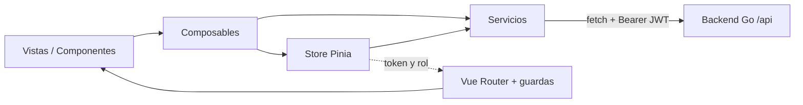

# Documentación Técnica – Frontend

Aplicación web SPA para el **inventario de herramientas y carritos**. Permite iniciar sesión, realizar el inventario de carritos con firma digital, administrar usuarios y carritos, y gestionar préstamos de herramientas. Consume la API REST del backend Go.

## Índice

1. [Stack](#1-stack)
2. [Arquitectura](#2-arquitectura)
3. [Estructura de carpetas](#3-estructura-de-carpetas)
4. [Principios SOLID aplicados](#4-principios-solid-aplicados)
5. [Rutas y roles](#5-rutas-y-roles)
6. [Estado y autenticación](#6-estado-y-autenticación)
7. [Servicios HTTP](#7-servicios-http)
8. [Tipos principales](#8-tipos-principales)
9. [Variables de entorno](#9-variables-de-entorno)
10. [Comandos](#10-comandos)
11. [Despliegue](#11-despliegue)

## 1. Stack

| Tecnología | Uso |
|---|---|
| Vue 3 (Composition API) + TypeScript | Interfaz y tipado |
| Vite 8 | Servidor de desarrollo y *build* |
| Vue Router 4 | Navegación y guardas por rol |
| Pinia | Estado global (sesión) |
| PrimeVue 4 + tema Aura | Componentes de UI |
| Tailwind CSS 3 | Estilos utilitarios |
| `fetch` nativo | Cliente HTTP |
| `vue-tsc` | Verificación de tipos |
| pnpm | Gestor de paquetes (Node ≥ 20.19) |

## 2. Arquitectura

Organización **por dominios**: cada dominio agrupa sus vistas, componentes, composables, servicios, store y tipos.



## 3. Estructura de carpetas

```text
src/
├── main.ts                    # Pinia, Router, PrimeVue (Aura), montaje
├── App.vue
├── assets/main.css            # Estilos globales (Tailwind)
├── router/index.ts            # Rutas y guarda beforeEach por rol
└── domains/
    ├── auth/
    │   ├── components/        # LoginForm, LoginHero
    │   ├── composables/       # useLogin
    │   ├── services/          # authService
    │   ├── store/             # useAuthStore
    │   ├── types/             # auth.types
    │   └── views/             # LoginView
    ├── stock/                 # Inventario de carritos
    │   ├── services/          # stockService
    │   ├── types/             # stock.types
    │   └── views/             # StockDashboard
    ├── prestamo/views/        # PrestamoDashboard
    └── admin/views/           # AdminDashboard
```

## 4. Principios SOLID aplicados

| Principio | Aplicación |
|---|---|
| **S** | Cada dominio separa vista, lógica (composables), estado (store) y acceso a la API (servicios) |
| **O** | Un nuevo dominio se agrega como carpeta y ruta sin modificar los existentes |
| **I** | Tipos específicos por dominio (`auth.types`, `stock.types`) |
| **D** | Vistas y stores dependen de los servicios, no de `fetch` directamente |

## 5. Rutas y roles

| Ruta | Vista | Acceso |
|---|---|---|
| `/` | — | Redirige a `/login` |
| `/login` | `LoginView` | Público |
| `/dashboard/stock` | `StockDashboard` | `operario`, `visualizador` |
| `/dashboard/prestamo` | `PrestamoDashboard` | `admin`, `inventario` |
| `/dashboard/admin` | `AdminDashboard` | `admin` |

Reglas de la guarda `beforeEach`:

- Sin token en una ruta con `requiresAuth`, redirige a `/login`.
- Con sesión activa en `/login`, redirige al dashboard del rol.
- `admin` solo permanece en `/dashboard/admin` (o préstamo); `operario` solo en stock; `inventario` solo en préstamo.

## 6. Estado y autenticación

`useAuthStore` (Pinia) expone `token`, `usuario`, `cargando`, `error`, `login`, `loginPorCedula` y `cerrarSesion`.

1. El login llama a `authService` y recibe `{ token, usuario, redireccionarA }`.
2. La sesión se persiste en `localStorage` (`inv_token`, `inv_usuario`) y se rehidrata al recargar.
3. El componente navega a la ruta indicada por el backend.
4. `cerrarSesion` limpia estado y almacenamiento.

## 7. Servicios HTTP

Base: `VITE_API_URL`. Los errores se leen de `{ error }` y se lanzan como `Error`.

| Servicio | Método | Endpoint |
|---|---|---|
| `authService` | `iniciarSesion` | `POST /auth/login` |
| `authService` | `loginPorCedula` | `POST /auth/login-cedula` |
| `stockService` | `obtenerCarritosAsignados` | `POST /carritos/asignados` |
| `stockService` | `obtenerDetalladoCarrito` | `POST /carritos/detallado` |
| `stockService` | `guardarInventario` | `POST /inventario/guardar` |
| `stockService` | `obtenerListadoPartes` | `GET /carritos/listado-partes` |

Las llamadas protegidas envían `Authorization: Bearer <token>`. Para visualizadores se envía `cedula` en lugar de `id_usuario`.

## 8. Tipos principales

| Tipo | Campos clave |
|---|---|
| `UsuarioAuth` | `id_usuario`, `empleado`, `nombre_completo`, `email`, `rol` |
| `RespuestaLogin` | `token`, `usuario`, `redireccionarA` |
| `DetalleCarrito` | `numero_carrito`, `nombre`, `registros`, `completados` |
| `ItemCarritoDetallado` | `referencia`, `descripcion`, `um`, `existencia`, `completado` |
| `RegistroInventario` | `cantidad_sistema`, `cantidad_fisica`, `novedad` (`ninguna`, `desgaste`, `faltante`), `accion_faltante` (`ninguna`, `descuento`, `compra`), `firma_digital` (Base64) |

## 9. Variables de entorno

| Variable | Descripción | Ejemplo |
|---|---|---|
| `VITE_API_URL` | URL base del backend | `http://localhost:8080/api` |

Plantilla en `.env.example`.

## 10. Comandos

```bash
pnpm install
pnpm dev          # servidor de desarrollo (Vite)
pnpm type-check   # vue-tsc
pnpm build        # type-check + build
pnpm build-only   # solo build
pnpm preview      # previsualizar dist/
```

## 11. Despliegue

El *workflow* `.github/workflows/ci-cd.yaml` ejecuta `pnpm install` y `pnpm run build-only`, y sirve `dist/` con `serve -s` mediante PM2 como `inventario_herramientas_frontend` en el puerto **3027**.

